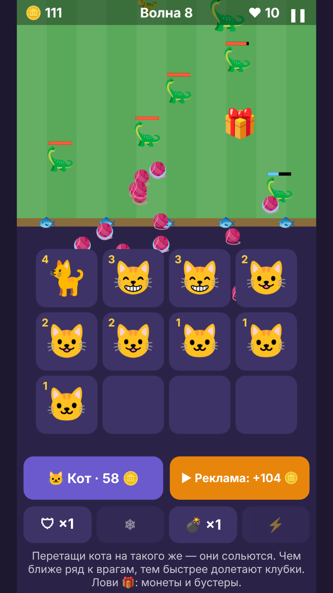
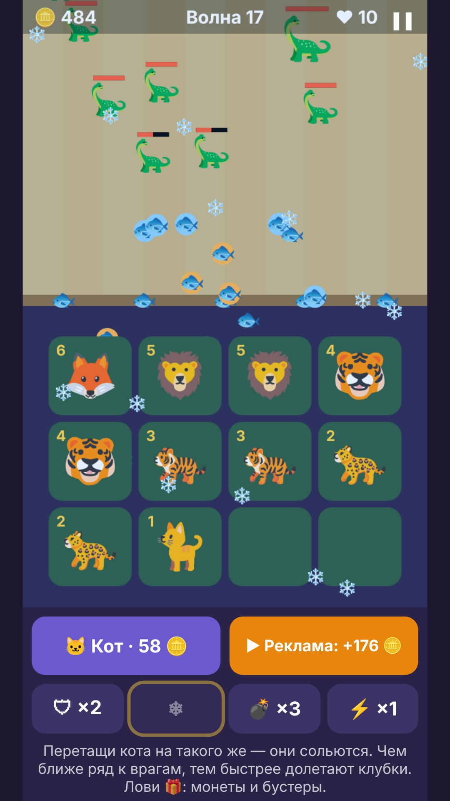
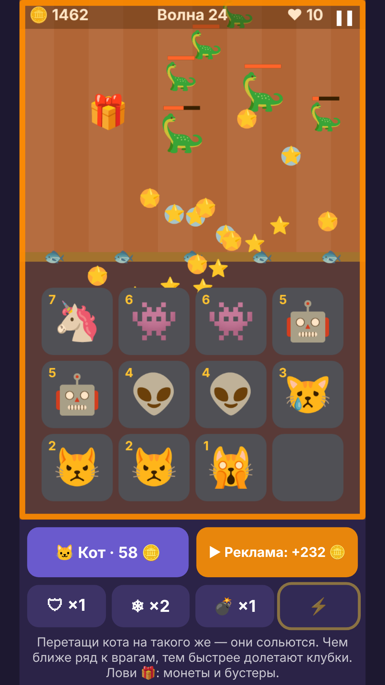
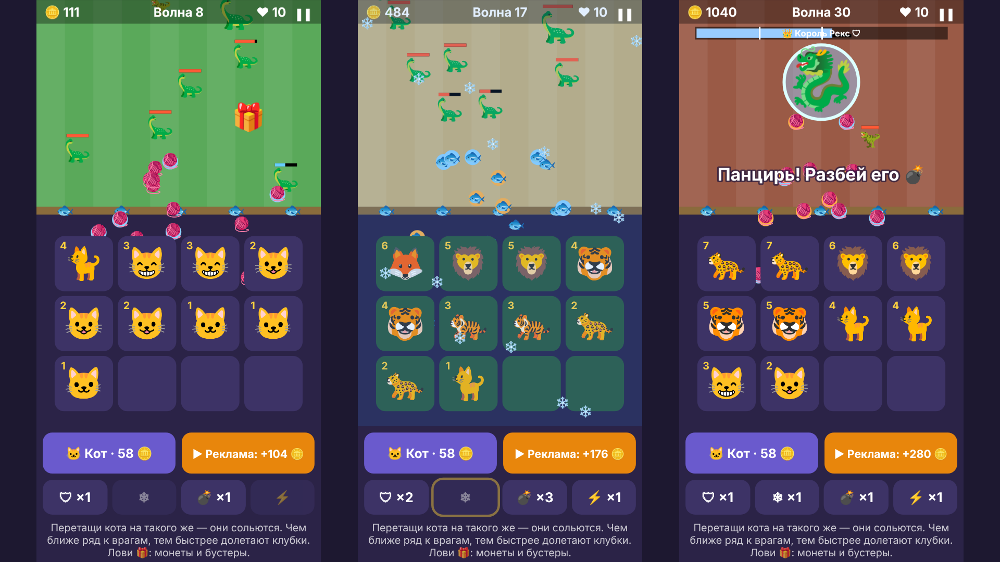

# Коты против динозавров

Браузерная игра в жанре «слияние + оборона» (merge + tower defense) для Яндекс Игр.

Покупай котят и соединяй одинаковых: два котёнка превращаются в кота посильнее, и так до короля прайда. Коты сами обстреливают динозавров клубками, а игрок решает, кого купить, кого слить и кого поставить в первый ряд. Каждые пять волн приходит босс, на 30-й волне — финальный противник Король Рекс. После победы открываются секретный скин и бесконечный режим.

  
  
  

## Возможности

- 30 волн, боссы каждые 5 волн, финальный босс и бесконечный режим после победы
- 4 бустера: щит, заморозка, бомба, ярость
- Подарки с монетами и бустерами, задания, достижения
- Скины котов и снарядов, включая секретный
- Продолжение забега после перезагрузки страницы
- Русский и английский язык (определяется автоматически)
- Работает на телефоне и компьютере: мышь, касания, перетаскивание

## Технически

- Один файл `index.html` без сборки и внешних зависимостей: HTML, CSS и JavaScript
- Отрисовка на Canvas 2D, адаптивное масштабирование под любой экран
- Вся музыка и звуки синтезируются в коде через Web Audio API, аудиофайлов нет. У босса своя тема
- Сохранения в localStorage с защитой от повреждённых данных
- Интеграция с Yandex Games SDK: реклама, пауза при сворачивании, GameplayAPI, язык. Без SDK игра запускается в обычном браузере

## Запуск

Открыть `index.html` в браузере. Или через GitHub Pages: Settings → Pages → Deploy from branch → `main` / root.
